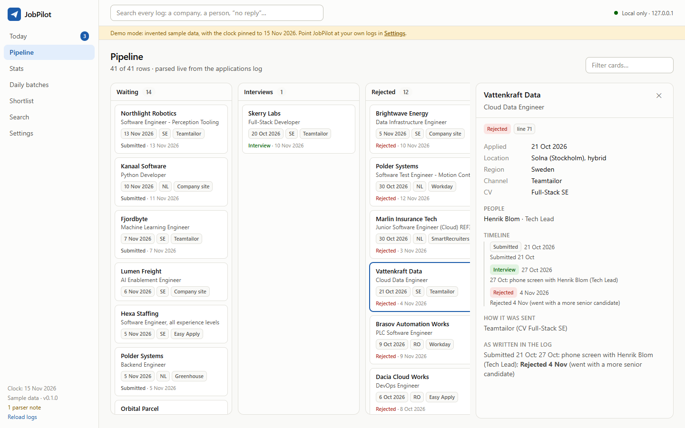
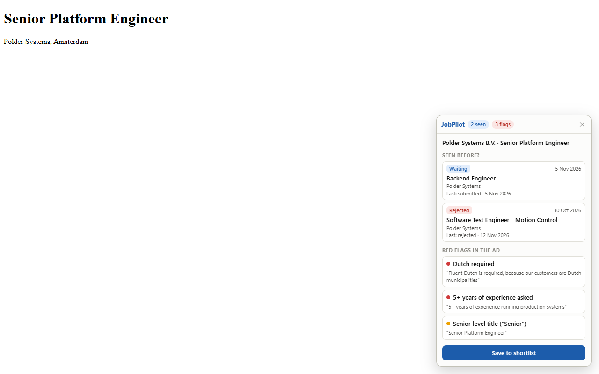

# JobPilot

[](https://github.com/andrei1234D/JobPilot/actions/workflows/ci.yml)

A local-first cockpit for a job hunt that lives in Markdown files. It reads an applications log, an outreach log and
daily batch reports (never editing them) and answers one question each morning: **what needs me today?**

One TypeScript monorepo, shipped three ways: a web dashboard, a Chrome extension and a Windows desktop app, all sharing
the same Zod schemas, parsers and rules.


> Screenshots use invented sample data (`sample-data/`). The repo runs on it out of the box.

## Features

- **Today:** follow-ups due (8–10 days after applying, one per application), stale connection requests, the "needs me"
  list as checkboxes, today's batch, and a check for rows whose status and section disagree.
- **Pipeline board** with a timeline of dated events read from each row's free text.
- **Stats:** per-week chart, answer rate and time to rejection by region, channel and CV.
- **Search** across all logs, with matches highlighted. **Company page** for the "did I already apply here?" check.
- **Chrome extension** (LinkedIn, Teamtailor, Workday, Greenhouse, Lever, Ashby): earlier applications for the company,
  red flags in the ad (with the sentence that triggered each), one-click shortlist.
- **Desktop app:** tray icon with the follow-up count, morning notification, start with Windows.

| Pipeline | Extension on a posting |
|---|---|
|  |  |

## Design

```
packages/shared   Zod schemas, tolerant Markdown parsers, pure rules (followUpsDue, redFlags, isRepeat, stats, search)
apps/server       Fastify API over the parsed logs, file watcher, live updates (SSE), bound to 127.0.0.1
apps/web          React + Vite + TanStack Query + Tailwind dashboard
apps/extension    Manifest V3: content script, service worker, popup
apps/desktop      Electron shell around the same server and UI
```

- **One schema, three apps.** Types are inferred from Zod schemas that the server, dashboard and extension all use, so
  a changed field is a compile error and a runtime error at the boundary.
- **A parser that cannot crash.** Real logs are messy (`~Sep 2026`, `by 25 Sep`, rows with extra pipes). Unknown input
  is shown as raw text with a note, never dropped.
- **Pure rules.** Data and a date go in, a list comes out; each rule has direct unit tests.
- **Read-only on the logs**, checked by a test that compares the files byte for byte after every write endpoint ran.
- **Local only.** Loopback binding, a Host-header check against DNS rebinding, an Origin allowlist for writes, no
  telemetry. The extension is granted one origin (`127.0.0.1:47321`). Electron runs with context isolation and a
  four-function preload bridge.

## Run it

Requires Node 20+ and pnpm.

```bash
pnpm install
pnpm start        # http://127.0.0.1:47321, sample data until you set your own paths in Settings
pnpm check        # typecheck + lint + unit tests
pnpm e2e          # Playwright (pnpm exec playwright install chromium)
```

Desktop: `pnpm --filter @jobpilot/desktop pack` (unpacked app) or `dist` (installer), then
`scripts\install-shortcuts.ps1` for Desktop and Start Menu shortcuts. Extension: `pnpm --filter @jobpilot/extension build`,
then load `apps/extension/dist` unpacked in `chrome://extensions`. Pushing a `v*` tag builds the Windows release in CI.
The installer is unsigned, so SmartScreen warns once.

Log files are set in **Settings**, or with `JOBPILOT_APPLICATIONS_LOG`, `JOBPILOT_OUTREACH_LOG`, `JOBPILOT_BATCHES_DIR`.
Expected format: `##` sections whose heading sets the status, each with a pipe table (see `sample-data/`). Columns are
matched by header name.

## Tests

About 235 unit tests (dates, parsers on the sample and on broken input, every rule, every API endpoint, the
read-only and local-only guarantees, the extension's extraction) and 5 Playwright tests, including the built extension
loaded into Chromium. CI runs typecheck, lint, tests, builds and the browser tests on every push.

## Limitations

Built around one family of log layouts; contacts and events are heuristics over prose (the raw text is always shown);
extension site selectors are fallbacks behind schema.org data; desktop packaging targets Windows.

MIT licensed.
