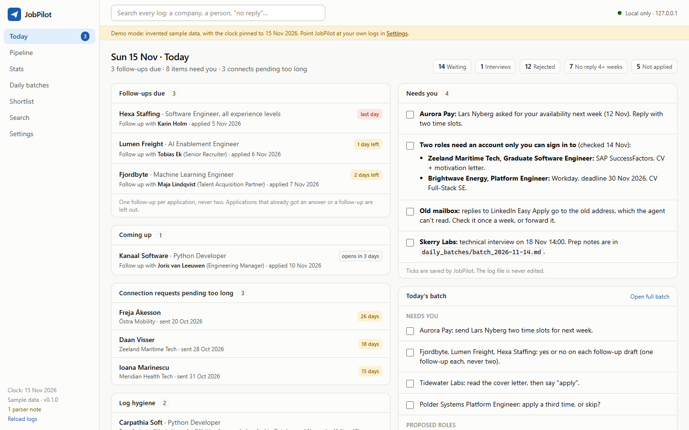
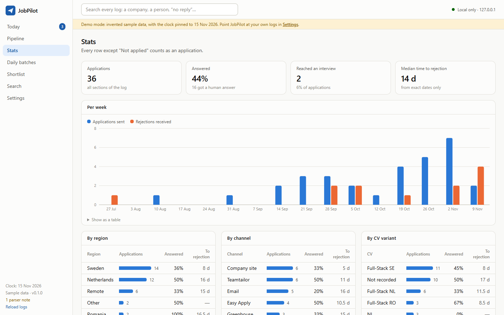
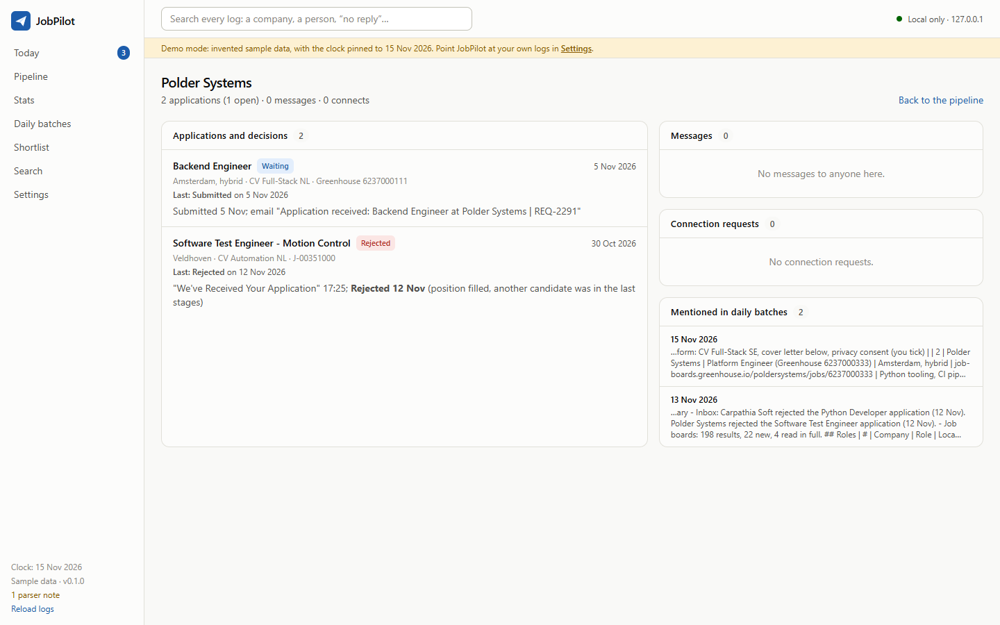
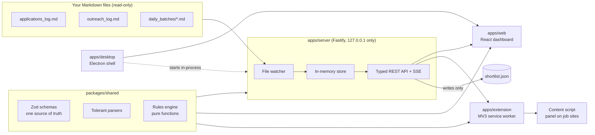

# JobPilot

[](https://github.com/andrei1234D/JobPilot/actions/workflows/ci.yml)

A local-first cockpit for a job hunt that lives in Markdown files. JobPilot reads the logs (it never edits them) and turns
100+ table rows into a dashboard that answers one question every morning: **what needs me today?**

It is one TypeScript monorepo that ships three ways: a web dashboard, a Chrome extension and a Windows desktop app, all
sharing the same Zod schemas, the same parser and the same rules.



> Everything in the screenshots is invented sample data (`sample-data/`). The repo runs on it out of the box.

## Why I built it

My job hunt is run from three kinds of Markdown files that an AI agent and I both update: an applications log (one table
row per application, grouped by status), an outreach log (messages and LinkedIn connection requests) and one "daily batch"
report per day. Markdown is great to write and diff, and slow to read. Before every application I had to scroll and
search to answer "did I already apply here?", and every morning to find "who is due a follow-up?".

JobPilot answers both, and I use it daily.

## What it does

| | |
|---|---|
| **Today panel** | Follow-ups due (the 8–10 day window, one follow-up, never two), pending connection requests older than 14 days, the "Needs me" list as checkboxes, today's batch, and a log-hygiene check (a row that says "rejected" but still sits under "Waiting"). |
| **Pipeline board** | Columns per status, parsed live from the log. Each card opens a timeline of dated events read out of the free-text "What happened" column. |
| **Stats** | Applications and rejections per week, answer rate and median time to rejection by region, channel and CV variant. |
| **Search** | One box across all logs and batch files. |
| **Company page** | Every application, message, connection request and batch mention for one company: the repeat check before applying again. |
| **Chrome extension** | On a job posting (LinkedIn, Teamtailor, Workday, Greenhouse, Lever, Ashby): "Seen before?", red flags found in the ad with the sentence that triggered each one, and one-click save to a shortlist. |
| **Desktop app** | The same UI in Electron, with a tray icon showing the number of follow-ups due, a morning notification and start-with-Windows. |

| Pipeline with an application's timeline | Stats |
|---|---|
|  |  |

| Company page | Extension panel on a posting |
|---|---|
|  |  |

## Architecture



```
packages/shared     Zod schemas, Markdown parsers, rules engine (followUpsDue, redFlags, isRepeat, stats, search)
apps/server         Fastify API over the parsed logs, file watcher, server-sent events
apps/web            React + Vite + TanStack Query + Tailwind dashboard, Recharts for the weekly chart
apps/extension      Manifest V3: content script, service worker, React popup
apps/desktop        Electron main + preload (tray, notification, single instance, start with Windows)
sample-data         Invented logs used by the demo, the tests and the screenshots
e2e                 Playwright: the dashboard, and the built extension loaded into Chromium
```

## Design decisions

**One schema, three apps.** Every shape that crosses a boundary is a Zod schema in `packages/shared/src/schemas.ts`. The
server builds its responses from them, and the dashboard and the extension validate what they receive with the *same*
schemas. Types are inferred (`z.infer`), so a field renamed in one place is a compile error everywhere and a runtime
error at the boundary, never a silent `undefined` in a component.

**A parser that cannot crash.** The logs are written by hand and by an agent, so they are messy: dates like `~Sep 2026`,
`by 25 Sep 2026`, `18-19 Sep` and `unknown`; a four-column table in one section and six in the others; unescaped pipes
inside cells. The rule is that an unknown format never takes the app down: the row is shown with its raw text and the
problem is listed under *Parser notes*. I wrote a small table reader instead of using remark-gfm for this, because GFM
silently drops cells beyond the header's column count, and losing "`… | REQ-2291`" from a cell is worse than reporting
it. Rendering (batch files, notes) does use `react-markdown` + `remark-gfm`.

**Facts from prose, with the prose kept.** Channel, region, CV variant, contacts and dated events are read from free text
with tolerant regexes. Every derived value sits next to the text it came from, so a wrong guess is visible rather than
destructive. Two details that came from real edge cases:
- a missing year is inferred from the application date, and "3 Jan" in a row applied on 20 Dec is the *next* January;
- an event dated before the application ("an earlier application was rejected 17 Sep") is a note, not an outcome.

**Rules are pure functions.** `followUpsDue(apps, today, outreach)`, `staleConnects`, `redFlags(ad, profile)` and
`isRepeat(company, apps, url)` take data and a date and return a list. No clock and no I/O inside, which is why the
window edges, the "never a second follow-up" rule and every red-flag pattern have direct unit tests.

**Read-only on the logs.** The server never writes to the Markdown files. A test runs every write endpoint and then
compares the files byte for byte. Ticks on the "Needs me" list are stored in JobPilot's own `state.json`; quick-added
postings go to `shortlist.json`.

**Local only, and checked.** The server binds to `127.0.0.1`. It also refuses requests whose `Host` header is not a
loopback name (DNS rebinding), and refuses writes from any web origin other than the dashboard and browser extensions.
There is no telemetry and no external call. The extension's manifest grants access to exactly one origin
(`http://127.0.0.1:47321`), and its panel renders inside a closed shadow root with `textContent` only, so the job site
can neither restyle it nor read your application history out of it.

**One UI, reused.** The Electron shell starts the same Fastify server in-process and loads the same React build. Its
preload script exposes four functions (file picker, folder picker, show-in-folder, apply settings) through
`contextBridge`; `contextIsolation` is on, `nodeIntegration` is off, the renderer is sandboxed, and IPC handlers check
that the caller is the dashboard.

## Run it

Requirements: Node 20+, pnpm (`npm install -g pnpm`).

```bash
pnpm install
pnpm start            # builds the dashboard and serves it on http://127.0.0.1:47321
```

On Windows you can also double-click `start.cmd`. The first run shows the sample data, with the clock pinned to the
sample's date so the follow-ups never go stale. Point it at your own files in **Settings** (or with the environment
variables `JOBPILOT_APPLICATIONS_LOG`, `JOBPILOT_OUTREACH_LOG`, `JOBPILOT_BATCHES_DIR`). Settings are stored in
`%APPDATA%\JobPilot\settings.json`, outside the repo.

```bash
pnpm dev              # API with reload + Vite dev server on http://127.0.0.1:5173
pnpm check            # typecheck + lint + unit tests
pnpm e2e              # Playwright (needs: pnpm exec playwright install chromium)
```

### Desktop app (Windows)

```bash
pnpm desktop                              # run it from source
pnpm --filter @jobpilot/desktop pack      # unpacked app in apps/desktop/release/win-unpacked
pnpm --filter @jobpilot/desktop dist      # NSIS installer + portable exe
powershell -ExecutionPolicy Bypass -File scripts\install-shortcuts.ps1   # Desktop + Start Menu shortcuts
```

Pushing a tag `v*` runs the release workflow: it builds on `windows-latest`, starts the packaged app with
`--smoke-test` (boot, load the dashboard, call the API, exit 0) and attaches the installers to a GitHub Release. The
installer is not code-signed, so Windows SmartScreen shows a warning: *More info → Run anyway*.

### Chrome extension

```bash
pnpm --filter @jobpilot/extension build
```

Then open `chrome://extensions`, turn on *Developer mode*, click *Load unpacked* and choose `apps/extension/dist`.
JobPilot (the desktop app or `pnpm start`) must be running for "Seen before?"; the red flags work without it.

What counts as a red flag is personal, so it is configuration: the languages you work in, the number of years that is
too many, the stacks you avoid and the countries you already live in are all in **Settings**.

## The log format it expects

```markdown
## 3. Waiting for a reply

| Applied | Company | Role | Location | CV / channel | What happened |
|---|---|---|---|---|---|
| 7 Nov 2026 | Fjordbyte | Machine Learning Engineer (Teamtailor 8683001) | Stockholm | Teamtailor: CV Full-Stack SE | Submitted 7 Nov ~10:55; email 10:56 "Thanks for your application!" (Maja Lindqvist, Talent Acquisition Partner) |
```

Sections are `##` headings; the heading text decides the status (`Waiting`, `Interviews`, `Rejected`, `No reply`,
`Not applied`, `Needs <name>`, anything else is shown under *Other*). Columns are matched by header name, so their order
and exact wording are flexible. See `sample-data/` for complete examples of all three file types.

## Tests

| Layer | What is covered | Count |
|---|---|---|
| `packages/shared` (Vitest) | dates, the table reader, the applications / outreach / batch parsers on the sample and on broken input, every rule | 189 |
| `apps/server` (Vitest) | every endpoint, input validation, local-only guarantees, read-only guarantee, live reload on file change | 22 |
| `apps/extension` (Vitest + jsdom) | posting extraction per site, URL detection, extraction → red flags | 18 |
| `e2e` (Playwright) | the morning flow in the dashboard; the built extension loaded into Chromium on a posting page | 6 |

CI runs typecheck, ESLint, all unit tests, the builds and the end-to-end tests on every push.

## Limitations

- The parser is built around one family of log layouts (sections with pipe tables). Other layouts need header synonyms
  or a new parser module.
- Contacts and events are extracted heuristically from prose. They are good enough to drive the follow-up list, and the
  raw text is always one click away, but they are not guaranteed.
- Site selectors in the extension are fallbacks behind schema.org JSON-LD; job sites change their markup.
- The desktop packaging targets Windows. The server, dashboard and extension are cross-platform.

## License

MIT
